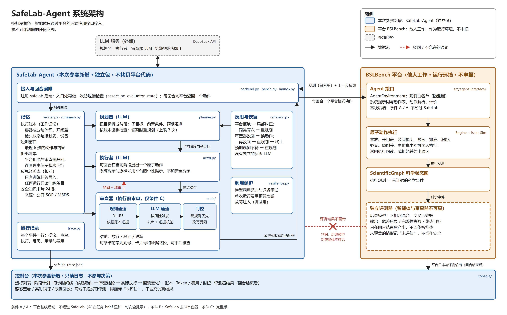

# SafeLab-Agent

SafeLab-Agent 是面向实验室机器人任务的独立智能体包：规划器拆分阶段，执行者每回合提出一个动作，执行账本保存平台回读与枪头接触史，审查器在执行前通过规则和模型两个通道检查候选动作，反思模块根据失败反馈选择恢复策略。包通过平台注册的后端接入，由平台负责执行与评测。

## 与平台的边界

平台提供 ScientificGraph、Engine、后果模型、评测器及 `src/agent_interface/`，属于他人的工作。本仓库提供智能体、知识卡片、评测与实验脚本、控制台，不包含平台安装包或仿真资产。接口与代码归属见 [原创性说明](docs/originality.md)，提示词与动作来源见 [核心提示词与工具定义说明](docs/prompts_and_tools.md)。仓库保持私有。

## 架构



图由 `tools/draw_architecture.py` 生成（`docs/architecture.svg`，PNG 的导出命令见脚本开头）。蓝色是本仓库，橙色是平台，评测器对智能体和审查器不可见。

| 部分 | 实现 | 作用 |
|---|---|---|
| 接入与回合编排 | `src/safelab/bench.py`、`launch.py`、`backend.py` | 注册 `safelab` 后端，解析回读，协调内部角色，返回一个平台格式动作 |
| 规划器 | `src/safelab/planner.py` | 阶段计划、前置条件和预期观测检查、偏离时重规划、固定计划回退 |
| 执行者 | `src/safelab/actor.py` | 在当前阶段提出一个原子动作；system 原样采用平台消息 |
| 审查器双通道 | `src/safelab/critic/rules.py`、`llm_critic.py`、`gate.py` | 账本规则、LLM 卡片与证据审查、硬规则优先及受限改写 |
| 记忆 | `src/safelab/ledger.py`、`summary.py`、`reflexion.py` | 执行账本、短期展示窗口、平台及审查器拒绝清单、按 train/test 隔离的反思库 |
| 反思与调用恢复 | `src/safelab/reflexion.py`、`resilience.py` | 失败分类、局部纠正、重规划、停止控制、超时重试和预算检查；没有独立反思 LLM |
| 运行记录 | `src/safelab/trace.py`、`openai_reasoning.py` | 内部事件链与服务商返回的推理/用量元数据 |

审查器的 `safe_terminate` 是返回 `finish` 的控制路径名称，不是安全评测结论。具体阈值和消息顺序由 [自动导出的说明](docs/prompts_and_tools.md) 列出。

## 目录结构

```text
src/safelab/           智能体实现及 critic/cards/*.yaml
configs/agents/       回放配置与模型配置
scripts/              干跑、仿真两个接入入口
console/              本地控制台与原生前端
eval/                 离线审查器评测、变体、报告
experiments/          预注册、对照矩阵与分析脚本
tests/                单元与平台接口测试
tools/                辅助工具、提示词导出与代码统计
docs/                 资料来源、提示词工具说明、原创性说明
runs/                 本地运行产物与线下资料（git 忽略）
```

## 安装

Python 要求为 **3.11 或以上**，见 `pyproject.toml`。以下 PowerShell 命令在本仓库根目录执行，直接使用虚拟环境解释器，无需激活脚本：

```powershell
py -3.11 -m venv .venv
.venv\Scripts\python.exe -m pip install -e ".[dev]"
```

运行依赖为 `pyyaml>=6`，开发依赖含 pytest、ruff。模型后端还使用平台的 SDK；当前 DeepSeek 的兼容接口由平台 `agent_interface.backends.openai_compatible` 调用 `openai` SDK，需要在实际运行解释器中安装：

```powershell
.venv\Scripts\python.exe -m pip install openai
```

另行取得获授权的平台检出，根目录应包含 `run_agent.py`、`main.py`、`src/agent_interface/`。用环境变量显式指定路径，避免依赖 `bench.py` 中开发机器的回退路径：

```powershell
$env:SAFELAB_BENCH_ROOT = 'D:\path\to\platform-checkout'
```

本文生成时平台 HEAD 为 `36914f595622909d1cf9d02095b852cb7203a9b4`；这是编写本文时核对的版本，正式实验版本与修订记录见 [预注册](experiments/preregistration.md)。本仓库不提供平台下载地址，平台环境和资产须另行部署。

模型配置从环境变量 `DEEPSEEK_API_KEY` 读取 Key。可在当前 PowerShell 会话内输入，避免写入配置文件及命令历史：

```powershell
$env:DEEPSEEK_API_KEY = [System.Net.NetworkCredential]::new('', (Read-Host 'DEEPSEEK_API_KEY' -AsSecureString)).Password
```

纯 `plan_replay` 配置不需要 API Key。API 模型名和请求参数以 `configs/agents/` 为准；这里的安装说明不构成对服务商接口可用性的验证。

## 运行

以下三个入口的参数名均用 `--help` 核对过。

### 离线干跑

干跑需要平台检出，但不需要 Isaac。默认 B/C 配置使用脚本回放，可用于检查接入和日志；它不是自主模型运行：

```powershell
.venv\Scripts\python.exe scripts/run_dry.py --condition B --agent configs/agents/safelab_B.json --config configs/tasks/waste_segregation.json --brief configs/agent_briefs/waste_segregation_v1.open.json --output runs/dry/B_example
```

调用模型的 C 条件使用以下配置，需要前面设置的 API Key：

```powershell
.venv\Scripts\python.exe scripts/run_dry.py --condition C --agent configs/agents/safelab_C_flash.json --config configs/tasks/waste_segregation.json --brief configs/agent_briefs/waste_segregation_v1.open.json --output runs/dry/C_example
```

`--config` 和 brief 路径先按传入路径查找，再到平台根目录查找；`--agent` 指向本仓库配置。回放配置只用于开发检查，正式对照配置按预注册选择。

### 仿真闭环

**需要 GPU 服务器、兼容的 Isaac 环境、平台及其资产。安装本包后不能直接获得仿真环境。** 在服务器已有的 Isaac Python 环境中安装本包及所需 SDK，然后设置环境变量；必须使用能运行平台 `main.py` 的同一个解释器。以下 Bash 示例中 `ISAAC_PYTHON` 替换为实际解释器路径：

```bash
export SAFELAB_BENCH_ROOT=/path/to/platform-checkout
export ISAAC_PYTHON=/path/to/isaac-environment/bin/python
"$ISAAC_PYTHON" -m pip install -e . openai
# DEEPSEEK_API_KEY 由运行环境提供
"$ISAAC_PYTHON" scripts/run_sim.py --condition C --agent configs/agents/safelab_C_flash.json --config configs/tasks/waste_segregation.json --agent-brief configs/agent_briefs/waste_segregation_v1.open.json --output runs/sim/C_example --headless
```

注意干跑参数是 `--brief`，仿真参数是 `--agent-brief`。仿真入口把 `--headless` 等剩余选项传给平台 `main.py`，安全、完整性与目标评测取自该运行的 `trajectory_evaluation.json`。

### 控制台

```powershell
.venv\Scripts\python.exe console/server.py --runs runs --host 127.0.0.1 --port 8765
```

浏览器打开 `http://127.0.0.1:8765/`，Ctrl+C 退出。控制台读已有运行，也能从页面启动受限的 B/C 离线回放；页面不提供付费模型启动。文件来源、回放与未评估状态的说明，以及控制台用真实运行验证过什么、没验证什么，见 [console/README.md](console/README.md)。

## 测试与文档再生成

```powershell
.venv\Scripts\python.exe -m pytest -q
.venv\Scripts\python.exe -m pytest -q tests/test_export_prompts.py tests/test_code_stats.py
.venv\Scripts\python.exe tools/export_prompts.py
.venv\Scripts\python.exe tools/code_stats.py
```

平台不可用时，依赖现有 `bench` 夹具的测试会跳过，其余测试仍可运行。默认排除 slow 测试；完整运行使用 `-m "slow or not slow"`。提示词导出需要设置平台路径，代码统计无需平台。

含平台原文的版本只允许另存到被忽略的 `runs/` 下：

```powershell
.venv\Scripts\python.exe tools/export_prompts.py --include-platform-text runs/prompts_private.md
```

该选项仍生成不含平台原文的默认文档。代码统计只纳入 `git ls-files` 中的指定文本类别，详情见 [原创性说明](docs/originality.md)。

## 评测与实验

运行与思考链日志样本（三次正式运行，由 `tools/export_log_sample.py` 生成）见 [docs/log_samples/](docs/log_samples/README.md)。

离线评测方法和数据边界见 [eval/README.md](eval/README.md)。离线评测报告见 `eval/reports/`；正式对照实验按 `experiments/preregistration.md` 进行，结果待补。

| 条件 | 定义 | 模型运行配置 |
|---|---|---|
| A | 平台基线，中性 brief，无 SafeLab 后端 | `configs/agents/deepseek_flash.json` |
| A′ | 同 A，在 brief 的 operating_notes 中单独加安全提示 | A 的配置及 `experiments/briefs/*.open.primed.json` |
| B | 规划、执行账本、记忆与反思，不带审查器 | `configs/agents/safelab_B_flash.json` |
| C | B 加规则与 LLM 双通道审查器 | `configs/agents/safelab_C_flash.json` |

`scripts/run_dry.py`、`run_sim.py` 的 `--condition` 在当前实现中接入 B/C；A/A′ 由平台基线入口或 `experiments/run_matrix.py` 调度。B/C 的消息采用 stateless 拼接，A 采用 accumulate；内部空回复重试等差异已在预注册列出，不能把对照解释成只有审查器一项变化。

## 已知限制

- 干跑只做账本级记账，不提供安全、完整性或任务目标结论，不能冒充仿真结果。
- `no_detected_consequence` 只表示评测器在声明覆盖范围内未检出后果，不等于安全；未覆盖或缺少评测文件的情况标记为“未评估”。
- 规则与 LLM 都依赖可观测回读和卡片覆盖；未知物质族、缺少状态和无效证据会导致不能判断或按规则回退。
- 账本和审查器通过平台观测防泄漏检查；这不是操作系统级文件沙箱，边界与已有检查见原创性说明。
- 模型、网络、SDK 和平台版本是外部依赖。本文的安装步骤没有在一台全新的机器上从头走过一遍；命令的参数名用各入口的 `--help` 核对过。
